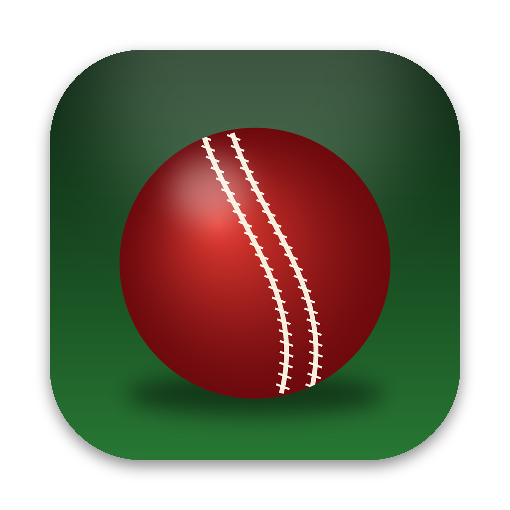

# Cricket 07 for Mac

A Mac app for playing **EA Sports Cricket 07** offline, built on [Dhaiwat](https://github.com/Dhaiwat10)'s
browser port of the game ([cricket07.dhaiwat.com](https://cricket07.dhaiwat.com),
[source](https://github.com/Dhaiwat10/cricket07-browser)).

Dhaiwat did the hard part: he translated the original 2006 Windows game to run in a browser, with
graphics rebuilt on WebGPU. This app wraps his port in a Mac window so it works without a browser and
without internet, and adds a few things for playing on a Mac.

<p align="center"></p>

## Download

1. Download the zip from the [latest release](https://github.com/udeshvirk/cricket07-mac/releases/latest):
   **arm64** for Apple Silicon Macs (M1 and later), **x64** for Intel Macs.
2. Unzip it and drag **Cricket 07 for Mac** to your Applications folder.
3. The app isn't signed with an Apple developer account, so macOS blocks it the first time.
   Open it once, then go to **System Settings → Privacy & Security** and click **Open Anyway**.
   (Or run `xattr -dr com.apple.quarantine "/Applications/Cricket 07 for Mac.app"` in Terminal.)

**The first launch needs internet.** It downloads the game from Dhaiwat's site (about 1.2 GB, a few
minutes), the same way the website does. After that it plays fully offline.

## What it adds

- **Offline play.** The game and the page that runs it are kept on your Mac after the first launch.
- **Straight into the game.** Opens full screen and starts solo play, with the picture filling the screen.
- **Real player names.** The game shows made-up names for players EA didn't license (S.Tendehar for
  Sachin Tendulkar, D.Dhenier for MS Dhoni). The game's own data has a second copy of the player list
  with the real names, and the app uses it for 394 players across India, Pakistan, West Indies, Sri Lanka,
  Zimbabwe, Bangladesh, Kenya, Australia, New Zealand and more. Turn it off in **Game → Real Player Names**.
  Ireland and Bermuda keep placeholder names, since the game has no real ones for them; rename them in
  the game's player editor.
- **Save backups.** Your saves are copied to `~/Documents/Cricket 07 for Mac Saves` at each launch
  (the newest 10 are kept). Back up or restore any time from the **Saves** menu.
- **Mac comforts.** Quitting from the game's menu or with ⌘Q closes the app straight away. The display
  stays awake while you play with a controller, and the game mutes when you switch to another app.

## Tips

- **Keep your settings:** the game only remembers settings such as difficulty when you save your
  profile: **My Cricket → Load / Save → Save**.
- **Controls:** a PlayStation or Xbox controller works. On the keyboard: arrows to move, **S** to select,
  **W** to go back, **Esc** to pause. ⌘K shows the full keyboard controls.
- **Full screen:** ⌃⌘F switches between full screen and a window.

## Not included

- **Online multiplayer** doesn't work in the app. Use [the website](https://cricket07.dhaiwat.com) for that.
- **No game files are in this repo or the download.** The app gets them from Dhaiwat's site on first launch.

## Build it yourself

```bash
npm install
npm start          # run
npm run dist       # build the zips into dist/
```

## Credits

- [Dhaiwat](https://github.com/Dhaiwat10): the browser port this app runs, and its hosting.
- [Stephan Cilliers](https://github.com/stephancill): deterministic scheduler, netplay and controller
  support in the port.
- Cricket 07 and EA Sports are trademarks of Electronic Arts. This is a fan project, not affiliated with
  or endorsed by Electronic Arts or by Dhaiwat.

MIT licensed (this app's code only).
