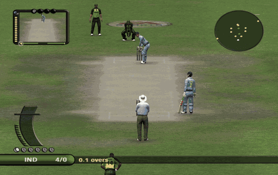
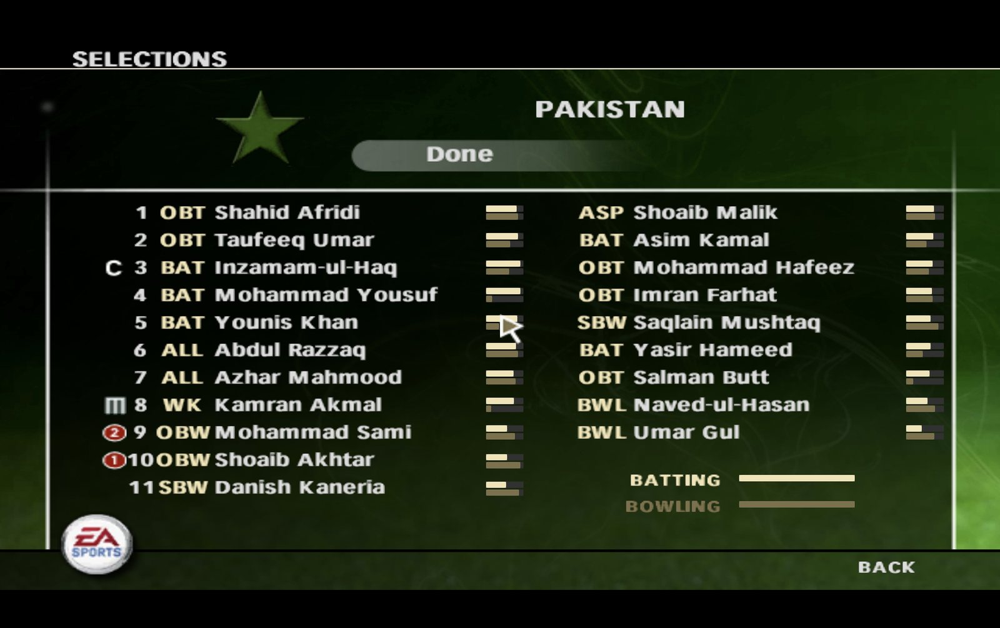
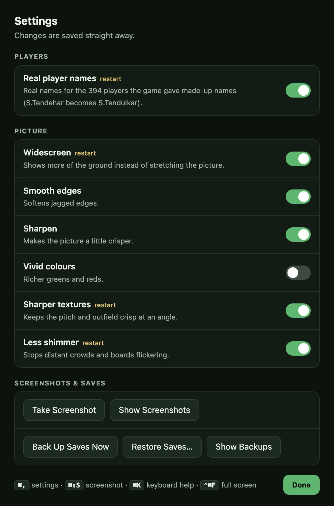
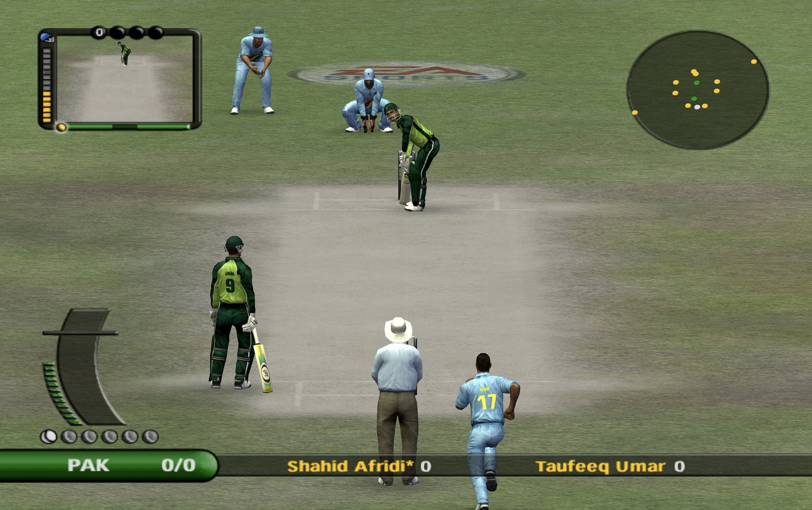
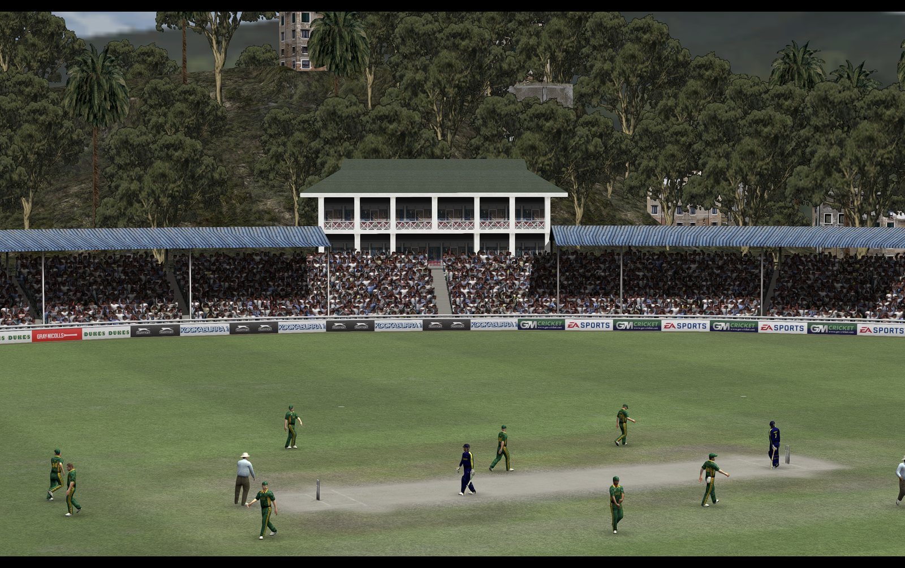

# Cricket 07 for Mac and Windows

Play **EA Sports Cricket 07** on your computer, offline, with real player names and a sharper widescreen picture.

Free, no ads. If you enjoy it, please give this page a **⭐ Star** (top right) so more cricket fans can find it.



## ⬇️ Download

| Your computer | Download |
|---|---|
| **Mac with an Apple chip** (M1, M2, M3, M4: most Macs from late 2020 onwards) | [**Download for Mac (Apple chip)**](https://github.com/udeshvirk/cricket07-desktop/releases/latest/download/Cricket07-Mac-Apple-Chip.zip) |
| **Mac with an Intel chip** (older Macs) | [**Download for Mac (Intel)**](https://github.com/udeshvirk/cricket07-desktop/releases/latest/download/Cricket07-Mac-Intel.zip) |
| **Windows 10 or 11** | [**Download for Windows**](https://github.com/udeshvirk/cricket07-desktop/releases/latest/download/Cricket07-Windows-Setup.exe) |

**Not sure which Mac you have?** Click the Apple menu  in the top-left corner and choose **About This Mac**.
If it says **Chip: Apple M…**, take the Apple chip version. If it says **Processor: Intel**, take the Intel version.

**What you need:** macOS 12 (Monterey) or newer, or Windows 10 or 11. On Windows, the graphics card needs
DirectX 12 (most PCs and laptops from 2016 onwards). About 1.5 GB of free space and an internet connection for the first launch.

All versions and what changed in each: [releases page](https://github.com/udeshvirk/cricket07-desktop/releases).

## Install on a Mac

1. Open your **Downloads** folder and double-click the file you downloaded. A **Cricket 07 for Mac** app appears.
2. Drag the app into your **Applications** folder.
3. Double-click the app to open it. The first time, your Mac says it can't check the app, because the app isn't
   registered with Apple. Click **Done** (or **OK**).
4. Open **System Settings** → **Privacy & Security**, scroll down, and click **Open Anyway** next to
   "Cricket 07 for Mac". Confirm with your password if asked.
5. From now on, the app opens normally.

## Install on Windows

1. Double-click the downloaded **Cricket07-Windows-Setup.exe**.
2. If Windows shows **"Windows protected your PC"**, click **More info**, then **Run anyway**. This appears
   because the app isn't registered with Microsoft.
3. Follow the installer. A **Cricket 07** shortcut appears on your desktop.

The Windows version is new: if something doesn't work, please [tell us](https://github.com/udeshvirk/cricket07-desktop/issues).

## The first time you play

- **Keep the internet on.** The game downloads once (a minute or two on a fast connection). After that it
  works without internet.
- Choose **Regular** (the whole game, about 740 MB) or **Lite** (no commentary, about 440 MB).
- The game opens full screen and goes straight in.

## Playing

| To do this | Keyboard | Controller |
|---|---|---|
| Move, aim a shot | Arrow keys | Left stick |
| Select, play a shot | **S** | ✕ / A |
| Go back | **W** | △ / Y |
| Lofted shot (hit it in the air) | Hold **Shift** + shot | Hold L1 / LB + shot |
| Pause | **Esc** | |
| All keyboard controls | **⌘K** (Ctrl+K on Windows) | |
| Settings | **⌘,** (Ctrl+, on Windows) | |
| Take a screenshot | **⌘⇧S** (Ctrl+Shift+S) | |
| Leave full screen | **⌃⌘F** (F11 on Windows) | |
| Quit | **⌘Q** (Alt+F4 on Windows), or Quit in the game's menu | |

**To keep your settings** (like difficulty): in the game, go to **My Cricket → Load / Save → Save**.
The game only remembers changes you save there.

## What's special about this version

| Real player names | Settings (⌘,) |
|---|---|
|  |  |

- **Real player names.** The original game used made-up names for many players (S.Tendehar for Sachin
  Tendulkar, D.Dhenier for MS Dhoni). This app shows the real names for 394 players.
- **Widescreen.** See more of the ground instead of a stretched picture.
- **A cleaner picture.** True anti-aliasing for smooth edges, HD (upscaled) textures, and less flicker on distant crowds.
- **Starts faster.** Skips the EA Sports logo movie (you can turn that off).
- **Plays offline** after the first download, and **backs up your saves** automatically.
- **Tells you about updates** when a new version is available.
- Everything can be switched on or off in **Settings** (⌘, or Ctrl+,).





**Not included:** online multiplayer. For that, play on [the website](https://cricket07.dhaiwat.com).

## Something not working?

**Black screen, or the game doesn't start**
- On the first launch, give it a few minutes: the game is downloading. Look for a small line of text in the middle of the screen showing progress.
- Press **⌘R** (Ctrl+R on Windows) to restart the game.
- If a message says no graphics adapter was found, your graphics card can't run the game. On Windows, update your
  graphics driver (from Intel, NVIDIA or AMD's website) and try again.
- Open **Settings** (⌘, or Ctrl+,) and switch off **Extra-smooth edges**, **HD textures** and **Widescreen**, then restart.

**The download stopped:** check your internet, then press **⌘R** (Ctrl+R). It carries on where it left off.

**Mac says the app can't be opened or checked:** follow steps 3 and 4 of [Install on a Mac](#install-on-a-mac).

**Still stuck?** [Tell us here](https://github.com/udeshvirk/cricket07-desktop/issues). Please say whether you use
a Mac or Windows, which computer it is, and add a photo or screenshot of the screen. That helps us fix it quickly.

## Credits

- [Dhaiwat](https://github.com/Dhaiwat10) made the game run on modern computers
  ([website](https://cricket07.dhaiwat.com), [source](https://github.com/Dhaiwat10/cricket07-browser)).
  This app is built on his work, and downloads the game from his site.
- [Stephan Cilliers](https://github.com/stephancill): controller support and online play in Dhaiwat's version.
- Cricket 07 and EA Sports are trademarks of Electronic Arts. This is a fan project, not affiliated with
  or endorsed by Electronic Arts or by Dhaiwat. No game files are included in this app.

---

### For developers

```bash
npm install
npm start          # run
npm run dist       # build the Mac zips into dist/
npm run dist:win   # build the Windows installer into dist/
```

Release files are uploaded as `Cricket07-Mac-Apple-Chip.zip`, `Cricket07-Mac-Intel.zip` and
`Cricket07-Windows-Setup.exe`, so the download links above always point to the latest version.
The Windows build is checked by an automated test (`.github/workflows/windows-test.yml`) on every release.

MIT licensed (this app's code only).
